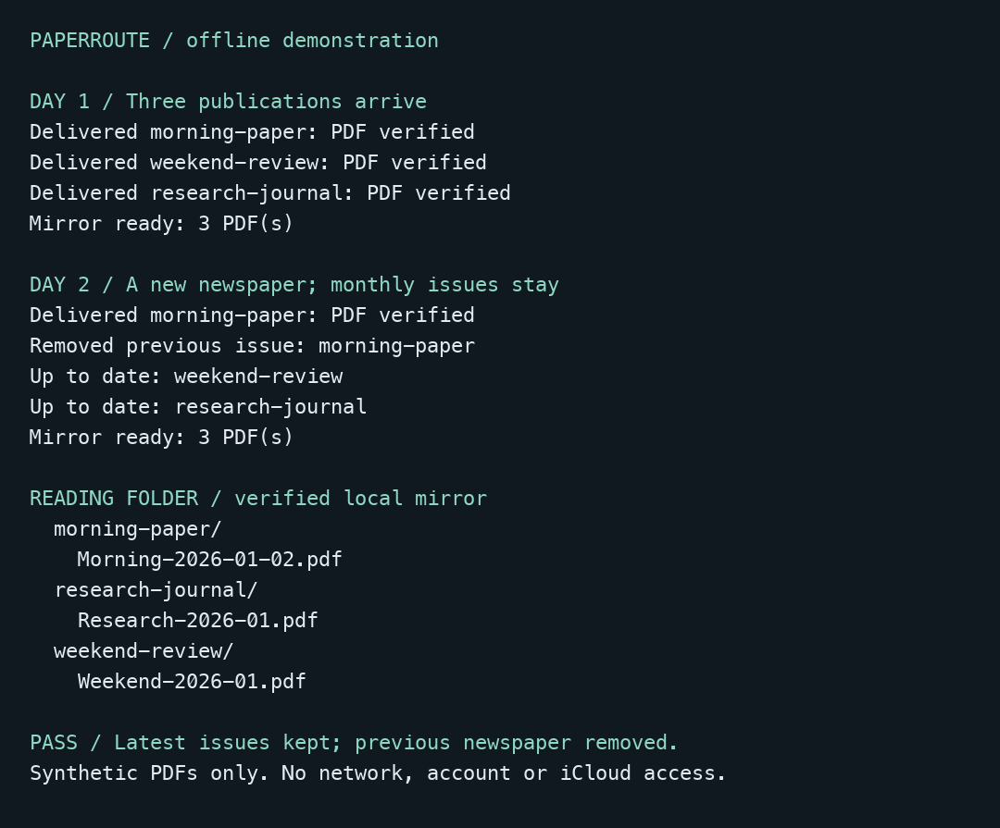

# PaperRoute

**Your reading, delivered to your iPad.**

PaperRoute collects the PDFs you want from Telegram and organizes them in iCloud Drive. Schedule a daily delivery, open Files on your iPad, and read. When a new issue arrives, PaperRoute can remove the previous one automatically.

It grew out of a daily routine: opening Telegram channels, finding newspapers, magazines and journals, downloading them, and clearing yesterday's files. The channel and filename rules are yours to choose.



*An actual offline run with synthetic publications. The second delivery replaces the newspaper and keeps the monthly reading.*

## Set it up with your agent

Give Codex or Claude Code this repository and say:

> Set up PaperRoute on my Mac. Follow SETUP.md, ask me for my publications and preferences, and verify a delivery before enabling the daily schedule.

The agent installs the Python dependency, helps you sign in to Telegram locally, configures your reading list, and checks the iCloud destination. You enter login secrets in your own terminal. Both agents use the same [setup procedure](SETUP.md).

## Try it without an account

With Python 3.11 or later:

```sh
python3 demo.py
python3 -m unittest discover -s tests -v
```

The demo runs two deliveries through the real download/cleanup/mirror pipeline, using a fake Telegram source and temporary folders. It makes no network requests and removes its synthetic PDFs afterward.

## What happens each day

1. PaperRoute looks through recent posts in each configured channel for filenames matching your publication rules.
2. It downloads the newest matching PDF to that publication's local folder and checks its header, expected size, and checksum.
3. If you confirmed cleanup during setup, it removes older issues it previously downloaded for that publication. Without a new matching issue, the existing one stays.
4. It copies the reading folder to its dedicated iCloud destination. Files unrelated to PaperRoute are left alone.

“Latest” means the newest matching **Telegram post**, not a date inferred from the document. Each publication scans up to 500 recent posts by default; adjust `scan_limit` for a busy channel. A narrow filename rule keeps editions, supplements and different publications distinct. The [configuration guide](SETUP.md#3-configure-your-reading) shows how.

The download folder is local, so a mirror failure doesn't discard a successful download. A rerun verifies existing files, resumes delivery, and retries the mirror. Edited PDFs are preserved and reported rather than overwritten or deleted. Save annotated copies outside PaperRoute's managed folders if you want cleanup to continue uninterrupted.

## Built with AI assistance

I chose the workflow, publication filters, and reading experience, and used coding agents to implement and refine the automation. This release makes the configuration reusable, adds agent-led onboarding, and tests the failure cases around downloads and cleanup. The code stays small: Python, Telethon, and macOS's scheduler.

## Development

The runtime is in `paperroute.py`; `demo.py` supplies synthetic Telegram messages and valid sample PDFs. The unittest suite exercises failed and repeated downloads, retention confirmation, edited files, path safety, and mirror recovery. No credentials are needed to run it.

MIT licensed. Telegram access is provided by [Telethon](https://github.com/LonamiWebs/Telethon), also MIT licensed. Bring your own Telegram account and API credentials; PaperRoute accesses channels that account can already read.
